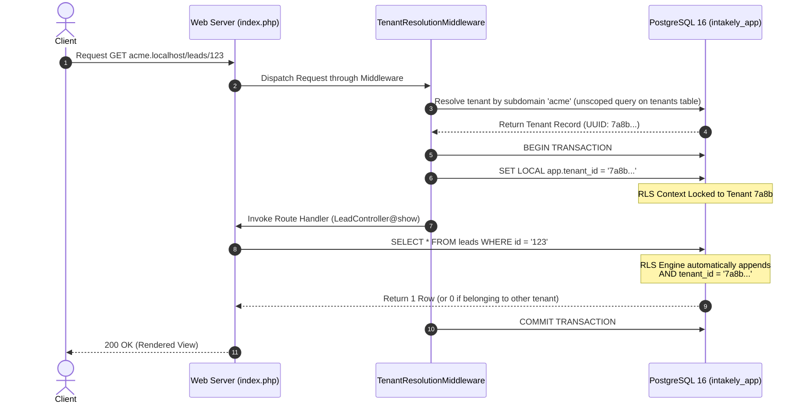

# Multi-Tenancy Architecture & Row-Level Security in Intakely

Intakely is architected for strict commercial multi-tenancy, prioritizing absolute customer data isolation and high query performance. Rather than maintaining separate databases or separate schemas per tenant (which introduce massive operational overhead, connection pool exhaustion, and migration friction at scale), Intakely employs a **shared schema with database-enforced Row-Level Security (RLS)** in PostgreSQL 16.

---

## 1. Core Threat Model

In conventional SaaS architectures where data isolation is enforced solely by ORM filters or application-level code (`WHERE tenant_id = ?`), a single developer oversight, un-scoped raw query, or IDOR vulnerability exposes one customer's sensitive legal or medical records to another.

In Intakely:
- Application code cannot bypass tenant isolation even if it completely omits the `WHERE tenant_id` clause.
- SQL injection cannot breach tenant boundaries because PostgreSQL rejects access to any row whose `tenant_id` does not match the active session context.
- Super-admin cross-tenant access is explicitly separated and cryptographically audit-logged.

---

## 2. PostgreSQL Role Separation (Least Privilege)

Three distinct PostgreSQL roles govern access:

1. **`intakely_owner` (Migrator / Schema Owner)**:
   - Owns all database objects, migrations, and DDL.
   - Runs migrations via `/bin/migrate.php` and executes `CREATE TABLE`, `ALTER TABLE`, and RLS policy declarations.
   - Superuser privileges are never granted to the web application.

2. **`intakely_app` (Application Runtime Role)**:
   - The non-superuser, non-owner role used by the PHP application.
   - Because `intakely_app` is **not** the table owner and **not** a superuser, it is strictly bound by RLS policies.
   - `FORCE ROW LEVEL SECURITY` guarantees that even table owners cannot bypass policies if accidentally executed under this role.

3. **`intakely_readonly` (Reporting & Telemetry Role)**:
   - Has read-only permissions (`SELECT`) for materialized views and read replicas.

---

## 3. Database RLS Policy Structure

Every tenant-owned table (`leads`, `pipeline_stages`, `forms`, `messages`, `tasks`, `appointments`, `audit_log`, etc.) enforces the following policy:

```sql
-- Enable and force RLS on all queries
ALTER TABLE leads ENABLE ROW LEVEL SECURITY;
ALTER TABLE leads FORCE ROW LEVEL SECURITY;

-- Enforce isolation on reads, updates, and deletes (USING),
-- and prevent cross-tenant record injection on inserts/updates (WITH CHECK)
CREATE POLICY tenant_isolation ON leads
    USING (tenant_id = current_setting('app.tenant_id')::uuid)
    WITH CHECK (tenant_id = current_setting('app.tenant_id')::uuid);
```

### Policy Mechanics:
- **`USING` clause**: Evaluated for `SELECT`, `UPDATE`, and `DELETE`. Rows where `tenant_id` does not match the active session setting simply evaluate to `FALSE` and are treated by Postgres as nonexistent. An attacker guessing a UUID ID in `/leads/{stolen-uuid}` receives an empty set (`0 rows`), preventing IDOR enumeration.
- **`WITH CHECK` clause**: Evaluated for `INSERT` and `UPDATE`. If an application bug attempts to insert or reassign a row to a different `tenant_id`, PostgreSQL immediately aborts the transaction with an RLS violation error (`ERROR: new row violates row-level security policy for table "leads"`).

---

## 4. Tenant Context Lifecycle per Request



1. **Resolution**: `TenantResolutionMiddleware` detects tenant identity via:
   - Subdomain (`apex-law.localhost` in development)
   - Custom domain (`apexlaw.co.uk` mapped in production)
   - Session fallback (for logged-in user sessions)
2. **Context Establishment**: Before executing the route handler, the middleware opens a transaction and issues:
   ```sql
   SET LOCAL app.tenant_id = '7a8b9c...';
   ```
   `SET LOCAL` binds the variable **only to the lifetime of the current transaction**, preventing connection-pool bleed or leaks across keep-alive requests.
3. **Automatic Enforcement**: All subsequent queries executed by controllers or models automatically inherit the filter without manual intervention.

---

## 5. Automated Verification Test Suite

Run the automated test proving database-level isolation:
```bash
php bin/test.php
```

The test executes three adversarial simulations:
1. **Isolated Reads**: Confirms that when `app.tenant_id` is set to Tenant A, a generic `SELECT * FROM leads` returns 0 rows belonging to Tenant B.
2. **ID Guessing / IDOR Attack**: Injects the exact UUID of a Tenant B lead into a Tenant A query. Confirms that `SELECT`, `UPDATE`, and `DELETE` all affect 0 rows.
3. **Spoofed INSERT**: Attempts to write a row with `tenant_id = Tenant B` while authenticated as Tenant A. Confirms that PostgreSQL raises an RLS `WITH CHECK` violation exception and rejects the write.
